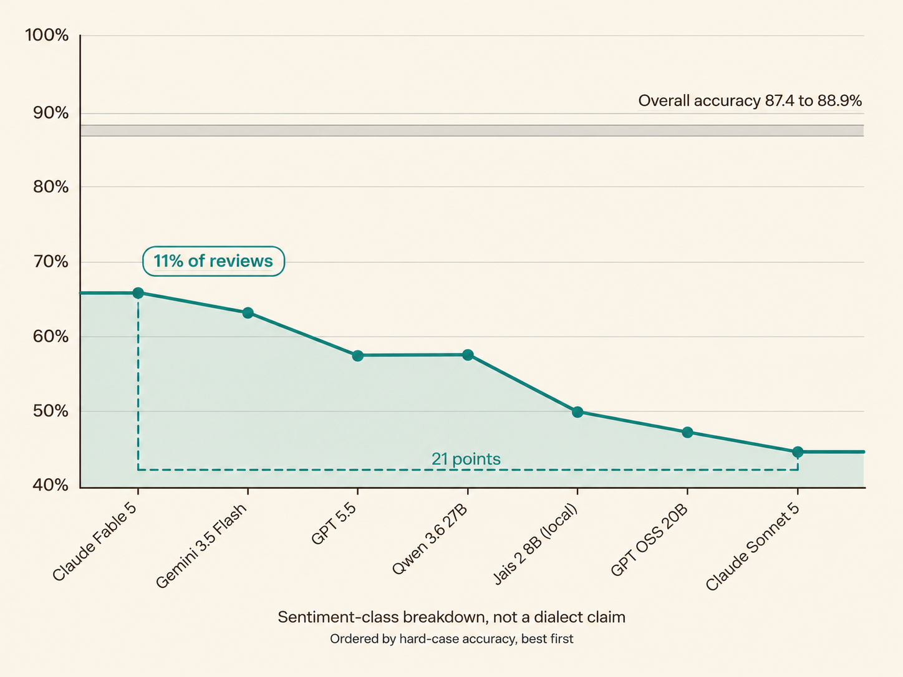

# KhaleejiBench

I wanted to know how well LLMs read sentiment in Gulf Arabic, so I built a small test from app reviews of talabat, noon and Careem. This repo has the 333 labeled reviews, every answer seven models gave, and the script that scores them. The write-up is at [khaleejibench.web.app](https://khaleejibench.web.app).

<picture>
  <source media="(prefers-color-scheme: dark)" srcset="figures/hard-cases-dark.png">
  
</picture>

## Results

All seven models scored within 1.5 points of each other overall. They pull apart on the 38 reviews labeled mixed or neutral, where accuracy ranges from 44.7% to 65.8%.

| Model | Overall | Mixed or neutral | Correct of 38 |
|---|---|---|---|
| Claude Fable 5 | 88.3% | 65.8% | 25 |
| Gemini 3.5 Flash | 88.3% | 63.2% | 24 |
| GPT 5.5 | 88.9% | 57.9% | 22 |
| Qwen 3.6 27B | 88.0% | 57.9% | 22 |
| Jais 2 8B (local) | 87.4% | 50.0% | 19 |
| GPT OSS 20B | 88.6% | 47.4% | 18 |
| Claude Sonnet 5 | 88.0% | 44.7% | 17 |

Each model saw every review once in July 2026, with the same prompt and no examples. Confidence intervals and pairwise tests are in [`results/report_2026-07.md`](results/report_2026-07.md).

<details>
<summary>The prompt</summary>

```text
Classify the sentiment of this Arabic customer review as exactly one word: positive, negative, neutral, or mixed. Respond with only that single word, nothing else.

Review: {text}
```

</details>

## Data

Nine native Gulf speakers from the UAE, Saudi Arabia, Oman and Kuwait labeled the reviews and judged which ones are Khaleeji, or Gulf Arabic. Of the 333, 204 are Khaleeji and 129 are in other dialects. The raters wrote 121 of the Khaleeji reviews themselves.

The other 212 come from the app stores. I don't redistribute their text, so `data/labels.csv` lists them by id and label only. Open an issue if you need the text for research.

## Files

- `data/` has the labels and the 121 written reviews
- `results/` has every model answer and the report
- `score.py` scores a predictions file against the labels
- `prepare.py` builds `data/` from my private source files and won't run without them
- `archive/` has the July collection scripts, unedited

## Rerun the scoring

```
pip install -r requirements.txt
python score.py results/predictions_2026-07.csv
```

This rewrites `results/report_2026-07.md`, and you should get the same file back.

## Limitations

- The mixed and neutral set has only 38 reviews. The best and worst models are 8 reviews apart, and no pair of models differs significantly on those 38 once you correct for 21 comparisons.
- Most mined reviews have one rater's label, and those raters could only choose positive, negative or neutral. Only written reviews can be mixed, so a model that answers mixed on a mined review is always marked wrong.
- Four written reviews labeled mixed got a different answer from every model. They are `self_032`, `self_045`, `self_050` and `self_078`. I kept the original labels, because changing them after seeing the answers would bias the scores.
- Gemini's first answers to 14 reviews came back cut off. I reran those once and scored the reruns. The rerun file lists them, and the main predictions file already includes them. Without them Gemini scores 84.7% overall.
- The models ran with different reasoning and token settings, which the scripts in `archive/` show. I didn't keep the script or settings for the Claude Fable 5 run.
- Jais answered in Arabic three times with مختلط, which means mixed. The collection script didn't recognise those, so they count as unreadable, and all three would have been wrong anyway.

## License

The code is MIT licensed and the data is CC BY 4.0.

Sami Haj Latouf, 2026.
